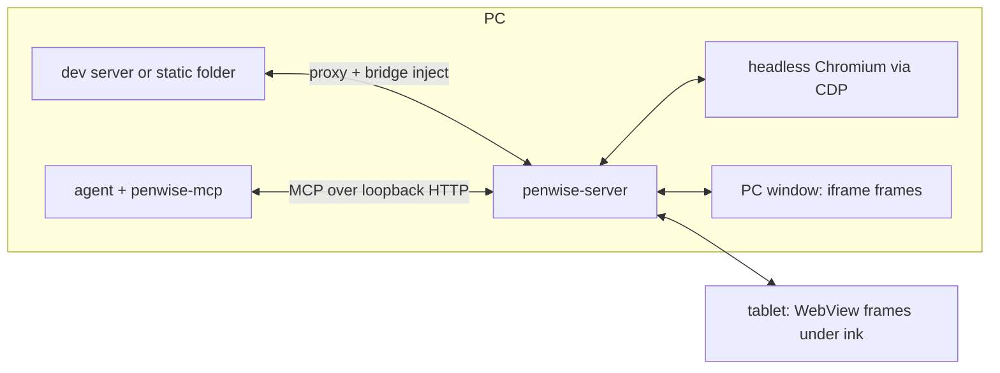

# Penwise design harness — spec (v1)

Status: **v1 built and in use** (2026-10-29). The decisions below are the design of record; §13 lists where the
code differs. Owner-facing guide: `docs/design-harness.md`. Decisions marked **[owner]** came from the interview;
**[default]** are the orchestrator's choices.

| Milestone | Result | Commit |
|---|---|---|
| M0 — serving, proxy, bridge injection, CDP inspect, WebView frames | done | `e8d6ce0` |
| M1 — `penwise link`, registry, `Frame`, frames on tablet and PC | done | `c72d4b3` |
| M2 — marks, binding, presets, state, status | done | `fe4d7ad` |
| M3 — mark bundles, classifier, agent tools | done | `412cd2a` |
| M4 — ghosts, variants, choice, cheat sheet | done | `270f8d6` |
| M5 — Vite/Next adapters, MCP config writer, docs | done | `2b2b9b6` |

## 1. Goal

Draw on a **live** web page from the tablet while iterating on a frontend with an agent in the PC terminal
(omp, Claude Code, …). Ink carries meaning, so the agent understands the *feel* of a request ("too heavy",
"move this here", a rough wireframe) without the owner writing it out in words. The agent answers in the
terminal and proposes changes on the canvas as **ghosts** or **variants** before it edits code.

First target project: `~/workspace/PersonalBranding/site` (plain HTML/CSS/JS, no dev server, no framework).

## 2. The loop

```mermaid
sequenceDiagram
    participant O as Owner (tablet + PC)
    participant P as Penwise (server + bridge)
    participant A as Agent (terminal, MCP)
    O->>P: penwise link (once per project)
    A->>P: create frame (route, size)
    P-->>O: live page on tablet + PC window
    O->>P: finger scrolls/clicks, pen marks (bound or area)
    O->>A: "look at what I marked" (terminal)
    A->>P: marks since last check
    P-->>A: per mark: meaning, handwriting, element, source file:line, crops
    A->>P: ghost or 2–4 variants (temporary patches)
    O->>P: pick a variant / write on it
    A->>A: edits the real code
    P-->>O: live reload; done marks hide
```

## 3. Scope

**v1 (in)**
- Projects linked with a CLI; Penwise proxies (or serves) the dev site.
- **Frame** items: a live page at a chosen size preset, on any canvas page; several frames per page.
- Tablet: finger scrolls/clicks the live page, pen always draws; two fingers still pan/zoom the canvas.
- Marks in two modes: **bound** (follows an element) and **area** (fixed at a document position).
- Marks remember the page **state** (menu open, etc.) and are per **size preset**.
- Mark meaning: a small fixed vocabulary + free interpretation; colour meaning; cheat sheet in the PC app.
- Mark status `new → seen → done` (done = hidden, can be shown again; reopen).
- Agent tools (MCP): read marks with full context, set status, create frames, snapshot, ghost, variants,
  read the owner's pick.
- Source mapping: plain HTML/CSS via DevTools (no plugin); adapter interface for frameworks.

**Later (out of v1)**
- Live public sites (owner: not now).
- Agent notes/arrows on the canvas (owner: replies go to the terminal).
- Branch/worktree-based variants (patches cover v1).
- Framework adapters beyond the first two (§7.3).
- Multi-user, remote access beyond LAN/Tailscale.

## 4. Concepts

| Concept | Meaning |
|---|---|
| **Project** | A linked folder: `id`, `name`, root path, dev origin (or "served by Penwise"), adapter, notebook id |
| **Frame** | Canvas item: `project`, `route` (path + query), `preset` (`phone 390×844`, `tablet 834×1194`, `desktop 1440×900`, custom), position/size on the page, current `scroll`, optional `patch` (ghost/variant; ≤ 64 KiB of P1 JSON), `label` (≤ 80 bytes), `group` (variant group id, ≤ 64 bytes) and `chosen` (the owner's pick, exclusive within its group) |
| **Mark** | A group of strokes the owner drew on a frame in one go (strokes within ~1.5 s and nearby belong together) |
| **Binding** | `bound`: element key + offset from the element's top-left (no scaling, **[owner]**); `area`: document x/y in the frame page (scrolls with the page, clipped to the frame) |
| **State** | The interaction recipe active when the mark was drawn (e.g. `click nav > button.menu`), replayable |
| **Status** | `new`, `seen`, `done`, `reopened`; `done` marks are hidden unless "show done" is on |
| **Patch** | `{css, dom: [{op, selector, html}]}` applied by the bridge without touching files; a **ghost** is one patch on the frame; **variants** are 2–4 frames with different patches |
| **Element key** | Stable identity for binding: source location (`file:line:col`) when known, else a fingerprint (tag, id/classes, role, text, DOM path) |

## 5. Owner decisions (interview)

| # | Decision |
|---|---|
| 1 | Workflow: tablet draws over the dev site while the owner chats with the agent on the PC **[owner]** |
| 2 | Own local dev servers only, no live public sites for now **[owner]** |
| 3 | Finger scrolls/clicks the page, pen always draws **[owner]** |
| 4 | Two binding modes: bound (moves with the element, never scales, removed when the element is gone) and area (stays at its document position; scrolled out of view = not visible) **[owner]** |
| 5 | One size at a time, owner chooses; phone and desktop have separate marks **[owner]** |
| 6 | Agent checks when asked; marks carry status and the agent can ask for "since last check" **[owner]** |
| 7 | Fixed vocabulary + free interpretation; colours mean something **[owner]** |
| 8 | Mostly drawing on top of the page; sometimes a blank canvas for detailed sketches **[owner]** |
| 9 | Marks remember page state (menus, modals) **[owner]** |
| 10 | Source plugin OK; must support several languages/frameworks **[owner]** |
| 11 | Agent replies in the terminal; ghosts and variants before real edits **[owner]** |
| 12 | Done marks hidden; can be brought back if the edit was poor **[owner]** |
| 13 | Setup via a small CLI, then it syncs and embeds with the project **[owner]** |
| 14 | Frames created mainly by the agent, also from the tablet **[owner]** |
| 15 | Mark vocabulary below accepted; cheat sheet in the PC app **[owner]** |

### Mark vocabulary

| Mark | Meaning |
|---|---|
| Circle / loop | Look here (focus) |
| Arrow | Move this there (tail = what, head = where) |
| Cross (X) | Remove |
| Wavy line under | Feels off (agent asks or proposes) |
| Box drawn in empty space | New thing here (contents = sketch/handwriting) |
| Line through text | Change this text (handwriting nearby = new text) |
| **Red** ink | Problem |
| **Blue** ink | Idea |
| **Green** ink | Good, keep |
| Anything else, handwriting | Read freely by the agent |

Recognition is a hint, not a rule: the server classifies each mark (`kind`, `confidence`) with simple geometry
and the agent sees both the hint and the image.

## 6. Architecture



### 6.1 Serving and proxying **[default]**
- Each linked project gets its **own port** on the Penwise server (`7421+`). The proxy covers the dev
  origin's root, so absolute URLs (`/main.js`, `/@vite/client`) work unchanged. A path prefix under `:7420`
  would break them.
- The **registry** (`GET/POST /projects`, `DELETE /projects/:id`) stores rows in the server database: id,
  name, root (unique, so re-linking is idempotent), target, port and notebook. Ports are persisted and reused
  across restarts; a new project takes the first free port from the base (`PENWISE_PROJECT_PORT`, default
  7421). `PENWISE_PROJECTS` stays as a development override. The routes take the sync token, or a
  same-machine loopback request (the `/pair/local` rule) so `penwise link` needs no token.
- Static projects (no dev server, like the portfolio) are served by Penwise itself, with file watching and
  live reload.
- WebSockets (HMR) pass through.
- HTML responses get the **bridge** script injected before `</head>`; nothing in the project changes.
- Access: same token as sync, as a cookie set by the frame bootstrap URL. LAN/Tailscale like the rest.
  The PC firewall must allow the project ports (the same `ufw` rule as for 7420, as a range).

### 6.2 Bridge (injected script)
- Reports to its parent (tablet WebView or PC iframe) over `postMessage`/JS interface:
  - scroll position and document size;
  - the route when the page changes it itself (`pushState`/`popstate`/hash), as `{t:"pw:route", route}`;
  - rects for the element keys of visible bound marks, updated on layout change via `ResizeObserver`/`MutationObserver`, throttled to a frame;
  - the hit element under a point (for binding on pen-up);
  - interactions (clicks, opened state) for the state recipe.
- Accepts `{t:"pw:scrollTo", x, y}` and `{t:"pw:navigate", route}` (same-origin paths only).
- Saves the scroll position per `location.pathname` in session storage before a reload/`pagehide` and restores
  it after load, so a live reload keeps the owner in place.
- Applies patches (ghost/variant) and replays states on request.
- Resolves element keys: the `data-pw-src` attribute (from an adapter) first, then a fingerprint match.

### 6.3 Canvas model (core + proto)
- Core is the single source of truth for placement, visibility, hit/erase/lasso and grouping (`penwise-core`
  `marks`); clients only feed bridge data in and draw what core says.
- New item kinds in `penwise-core`:
  - `Frame { project, route, preset, w, h, patch? }`;
  - a `binding` on stroke items (item codec v2): `{ frame, mode: Bound|Area, preset, key?, state, anchor }`,
    with the samples stored in **binding-local CSS px** (relative to the element, or document coords for
    `Area`); `anchor` is the page position the binding origin had when drawn (the offline/server fallback).
  - a `Mark` item kind: `{ frame, preset, status: new|seen|done|reopened, state, strokes }`.
- These are ops like any other, so they sync, undo and restore unchanged (edit codec v3 for the binding/mark
  fields; `MarkStatus` is an LWW field).
- Each client feeds the bridge's layout (preset, scroll, doc/viewport size, state, element rects; local only,
  never synced) into core, which computes the effective page position and clips to the frame. Hidden when:
  - the size preset differs;
  - the bound element is gone (`null`/absent rect);
  - the mark is done and show-done is off.
  A non-empty state that is not the frame's current state renders the stroke greyed ("replay state"), not
  hittable.
- `Mark` grouping happens in core on add-with-binding: newest mark with the same frame and preset, not done,
  last stroke ≤ 1500 ms ago and within 40 px → join; otherwise a new `new` mark. Status changes are ops
  (sync and undo).

### 6.4 Tablet
- An Android **WebView** per visible frame, beneath the transparent low-latency ink surface.
  - Finger events inside a frame go to the WebView (scroll/click).
  - Two-finger gestures stay canvas pan/zoom; the stylus always goes to ink.
- Spike first (§10, M0): WebView under a front-buffered `SurfaceView` with correct z-order and no added pen latency.

### 6.5 PC window
- `<iframe>` per frame at the preset size, scaled to the canvas zoom; ink layer on top (same wasm renderer).
- Cheat-sheet panel (mark vocabulary + colours).
- "Show done marks" toggle; per-frame preset switch.

### 6.6 Headless snapshots
- The server drives one headless Chromium (CDP) per active project. It is used for agent snapshots, element
  info and source mapping when no window is open, and for variants before the owner views them.

## 7. Agent interface

### 7.1 MCP tools (new)
| Tool | Purpose |
|---|---|
| `penwise_projects` | linked projects, dev origin, frames |
| `penwise_frame_open` | `{project, route, preset}` → frame on a page (agent mostly creates frames) |
| `penwise_frame_snapshot` | PNG of a frame with/without ink, at its preset and state |
| `penwise_marks` | `{project?, frame?, status?: new, since?: last-check}` → mark bundles (§7.2); records a check point |
| `penwise_mark_status` | `{id, status: seen/done/reopened, note?}` |
| `penwise_ghost` | `{frame, patch}` → shows the patch live on that frame; `{frame, clear}` removes it |
| `penwise_variants` | `{frame, patches: 2–4, labels}` → variant frames side by side |
| `penwise_choice` | which variant the owner picked, plus any ink on it (bundle) |
| `penwise_frame_reload` | reload after code edits (normally automatic via live reload/HMR) |

### 7.2 Mark bundle
```json
{
  "id": "mk_…", "status": "new", "frame": "fr_…", "route": "/", "preset": "phone",
  "state": ["click: nav > button.menu"],
  "binding": "bound",
  "kind": {"guess": "arrow", "confidence": 0.82, "from": "h1.hero-title", "to": "section#work"},
  "colour": "red/problem",
  "text": "less heavy",
  "element": {
    "selector": "h1.hero-title", "role": "heading", "text": "Hi, I'm …",
    "source": [{"file": "index.html", "line": 42}, {"file": "styles.css", "line": 118, "rule": ".hero-title"}],
    "styles": {"font-size": "72px", "font-weight": "800", "color": "#111"},
    "rect": [24, 180, 342, 160]
  },
  "images": {"with_ink": "…png", "without_ink": "…png", "context": "…png"}
}
```

### 7.3 Source mapping (multi-language)
- **Base, no plugin:**
  - CDP `CSS.getMatchedStylesForNode` gives the stylesheet URL and line for each matching rule;
  - the DOM node's origin comes from parsing the served HTML with locations;
  - JS-created nodes fall back to the fingerprint.
  - This covers the portfolio.
- **Adapters** add `data-pw-src="file:line:col"` at build time:
  - v1: a **Vite** plugin (JSX/TSX, Vue SFC, Svelte, Astro via their compilers) and a **Next.js** plugin;
  - later: server templates (Jinja/Django, ERB, Blade) via template comments.
- `penwise link` picks the adapter from the project files.

## 8. CLI: `penwise link`
Run in the project folder:
1. Detects the project type and dev command/port (from `package.json` scripts, `vite.config.*`, `next.config.*`), or a static folder.
2. Offers to install the adapter (shows the diff and asks first).
3. Writes `.penwise.json` `{project, adapter, dev: {command?, origin?}, serve_static?: "site/"}`.
4. Registers the project with the server and creates its notebook.
5. Writes the agent's MCP config for this project (`.mcp.json` / omp equivalent), asking first.

`penwise dev` (optional): starts the project's dev server and keeps it linked.

## 9. Edge cases
- **Element gone after an edit:** bound marks hide (owner rule). The bundle still lists them as `orphaned`
  so the agent can report it.
- **Element duplicated or moved to another route:** keep the binding to the best fingerprint match on the
  same route; if ambiguous, mark `ambiguous`.
- **Page height changes:** area marks keep document coordinates; marks beyond the new height show at the bottom edge, flagged.
- **Dev server down:** frame shows "dev server not reachable" + last snapshot; marks stay.
- **HMR full reload while drawing:** the stroke completes against the old layout and binds after the reload.
- **State replay fails** (selector changed): mark shown greyed with "state not reproducible".
- **Patch errors** (bad selector): ghost reports which ops failed; nothing else changes.
- **Cross-origin content** (iframes, external fonts) stays as-is; external iframes can't be inspected.
- **Fixed/sticky elements:** bound marks follow them (rect from the bridge); area marks scroll with the document.
- **Owner rotates the tablet or changes the canvas zoom:** frames keep preset size; only canvas zoom changes.

## 10. Milestones
| # | Deliverable | Done when |
|---|---|---|
| M0 | **Spikes:** WebView under the ink surface on the tablet (z-order, pen latency, finger scroll); per-project proxy with HMR + bridge injection; CDP source mapping on the portfolio | All three are demonstrated on the device and PC |
| M1 | `penwise link` + static serving + project registry; `Frame` item; frames on tablet + PC window; finger scroll/click | Portfolio is live on the tablet at the phone/desktop presets |
| M2 | Marks: grouping, binding (bound/area), per preset, state recording/replay, status, show-done toggle | Marks follow elements across an edit; hide when the element is removed |
| M3 | Agent tools: `penwise_marks` bundle (meaning, OCR, element, source, crops), status, snapshot, frame open | An agent in the terminal answers "what did I mark?" with file:line and intent |
| M4 | Ghosts + variants + choice; cheat sheet in the PC app | Owner picks a variant on the tablet; the agent applies it to code |
| M5 | Adapters: Vite, Next; `.mcp.json` writer; docs | A Vite project links and maps marks to component source |

## 11. Acceptance (v1)
1. `penwise link` in `PersonalBranding/site`, then the agent opens `/` at `phone` and it shows live on the tablet and the PC window within 2 s.
2. Finger scroll inside the frame scrolls the site, and the pen draws with today's latency.
3. A circle on the hero title, then a CSS edit that moves it: the ink moves with it. Deleting the element hides the mark.
4. `penwise_marks` returns that mark with `kind=circle`, the colour meaning, OCR text, `index.html:<line>` and `styles.css:<line>`.
5. The agent proposes 3 variants; the owner taps one; the agent edits the files; the frame reloads; the mark is `done` and hidden; "show done" brings it back.
6. Phone marks don't show at desktop and vice versa.
7. A mark drawn with the menu open replays the menu when selected.

## 12. Defaults to confirm
1. A port per project (7421+) instead of a path under 7420. Needed so absolute asset paths work. The firewall rule must cover the range.
2. Server-side headless Chromium (already installed) for snapshots and source mapping.
3. Mark grouping: strokes within 1.5 s and 40 px belong to one mark.
4. Size presets: phone 390×844, tablet 834×1194, desktop 1440×900, plus custom.
5. Frame ink is stored in frame coordinates, so marks are tied to the frame, not the canvas page.
6. Patches are CSS plus simple DOM ops (insert, replace, remove, set attribute); no arbitrary JS in v1.
7. The tablet's existing two-finger canvas pan/zoom stays even over frames; one finger inside a frame belongs to the page.

## 13. Deviations in the built code

Where the implementation differs from the sections above, the code is the reference.

**CLI and registry (§8).**
- Commands are `open`, `link`, `unlink` and `status`; there is no `penwise dev`, so the owner starts the dev
  server. `penwise link` also takes `--yes`/`-y` and `--no-adapter`.
- `link` asks three times: register, apply the adapter (Vite/SvelteKit/Next, default no), write the MCP config
  (default yes). It prints the config diff before touching a file. `.penwise.json` gains `adapter` when an
  adapter was applied; the MCP files are `.mcp.json` and `.omp/mcp.json` in the project root.
- Project ports are persisted and reused (first free from 7421, `PENWISE_PROJECT_PORT`); re-linking a root
  updates its row.

**Agent interface (§7).**
- `penwise-mcp` is a stdio MCP server that calls the server's loopback HTTP API; it is not an HTTP MCP endpoint.
- There is no `penwise_frame_reload`: live reload/HMR refreshes frames, and the tablet/PC chips reload by hand.
  `penwise_variants_clear` exists. `penwise_mark_status` accepts `new` as well as seen/done/reopened.
- `PENWISE_PROJECT` (set by `penwise link`) is the default `project` filter for `penwise_marks` and
  `penwise_frame_open` when the call omits it.
- The bundle has no top-level `orphaned`/`ambiguous` flag. A gone element is `element: null`; the agent reports
  it. `element.source` entries are `{url?, file?, line?, rule?}`, plus `{col, kind: "component"}` from an
  adapter. A source entry can be marked `inferred: true` when it came from an ancestor with `data-pw-src`.
- A patch is limited to 64 KiB, 200 DOM ops and 512-character selectors, sanitized on the server and again in
  the bridge. Variants are created in one edit batch.
- Frames default to the project's `<name> review` page (created on demand) and are placed right of the existing
  ones. Labels are at most 80 characters. `penwise_frame_open` does not switch the owner's page; the agent calls
  `penwise_switch_page` or the owner selects the page.

**Adapters (§7.3).**
- `data-pw-src="<root-relative path>:<line>:<col>"` is added only in dev builds, only to lowercase intrinsic
  elements; components get none. The server reads the element's attribute, else the nearest ancestor's, and
  marks that source entry `inferred: true`.
- Vite: `@penwise/vite-plugin` in `adapters/vite`, default export `penwise({root?})`; SvelteKit uses the same
  plugin. Next: `@penwise/next` in `adapters/next`, `withPenwise(config)`. Astro gets no adapter.
- The value is checked before use: no absolute path, no `.`/`..` segment, line and column at least 1.
- Adapter packages resolve from `PENWISE_ADAPTERS`, up to four ancestors of the CLI binary, else the checkout
  the binary was built from. With none, `link` skips the adapter step silently.

**Serving and source mapping (§6, §7.3).**
- Bridge keys are `v1|<data-pw-src>|<fingerprint>`. Resolution tries the exact attribute, then an id-anchored
  `nth-of-type` path, then a fingerprint; spec §6.2 named only the first and the last.
- Static projects map HTML lines by parsing the served document. Proxied origins have no served document, so
  their HTML has no file line without an adapter.
- Vite CSS maps `/src/x.css` and `/@fs/<abs>` (under the root) to `file:line`; Next CSS stays URL-only.
- With the dev server down, the proxy answers 502 `dev server <origin> unreachable`. The frame does not keep a
  last snapshot.

**States and marks (§6.3, §9).**
- A failed state replay leaves the mark greyed; there is no "state not reproducible" label.
- Only clicks that toggle `aria-expanded`, `details`/`dialog` open state, or a state class are recorded.
