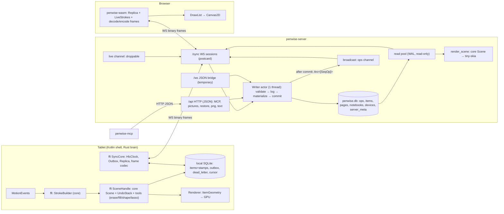

# Penwise rewrite — op log + HLC, `penwise-core` as the single page model

Status: design for owner review. HEAD `1dc2c08`. Read-only research; nothing in the repo was edited.
Sources: `PLAN.md` ("Data model", "Sync protocol"), `docs/contracts/m3-server.md` (the "M3 contract"), the
`penwise-proto` stubs, audit files (`local://audit/{server-data,core-model,system}.md` + `validated/`).
Where this document changes the M3 contract or a stub, it says so in §5 (every change is to unshipped,
unconsumed code: `penwise-proto` has zero dependents, so nothing here breaks a caller).
`path:line` citations are HEAD lines. `[INFERENCE]` = not run.

Order (owner's choice): **server + sync → tablet → browser.** §6 spells out why that order needs a
*time-boxed legacy bridge* so the live tablet/browser keep working until their milestones land.

---
## Owner decisions (2026-10-27) — override anything below that conflicts

1. **No legacy bridge.** Daily use pauses until the tablet milestone lands. D10, `legacy_ws.rs`, H-13 and every
   "bridge" step are dropped. The live DB still migrates losslessly (S2) and the tablet imports its legacy files (T4).
2. **Undo resets on app restart.** Core undo stays in-memory only; C-10 (undo serialization) is dropped.
3. **Retention: 7 days of log/tombstones; a device unseen for 30 days stops holding the floor.**
4. **Scale semantics = the tablet rule everywhere** (taper/nib/spray scale with size). Old server-PNG look is not preserved.
5. **Security hardening (S7) comes after the rewrite.** Single shared token stays for now.

---


## 0. Decisions in one table

| # | Decision | Why (one line) |
|---|---|---|
| D1 | `penwise-core` `Item`/`Scene`/`Edit`/`UndoStack` is the only page model on every surface. Flat `StrokeMsg` (`library/model.rs:22-38`), Kotlin `StrokeStore`, `draw.js` builders are deleted. | one erase rule, one undo, one seed type, one layer field |
| D2 | Sync = append-only op log, HLC stamps, per-(item, field) LWW, server-assigned global `seq`, create-before-reference, as in the M3 contract. | tombstones fix the "cannot tell deleted from never-had" root cause (SERVER-DATA-02) |
| D3 | Wire = **binary postcard** frames `[FRAME_VERSION][postcard]` for `/sync`; JSON only on `/api` (HTTP/MCP). | §4.5 |
| D4 | The server DB is only ever written by **one writer** (a dedicated thread/actor); reads use separate WAL connections; no in-memory page cache that can diverge. | kills the 09/10/11/12 bug class structurally |
| D5 | Deletes are tombstones (`Deleted` register); physical purge only below a per-device-ack floor + retention (§3.5); a client behind the floor gets a snapshot, never a silent diff. | answers the validated review's "tombstone retention vs offline clients" gap |
| D6 | Undo is **local-only state that emits ordinary ops** (core `UndoStack`, `edit/undo.rs:1-20`); it is never synced and never rewrites the log. | already decided in core; multi-writer-safe by field-staleness |
| D7 | Item identity = ULID `ItemId`; the legacy seed stops being identity and becomes `StrokeItem.seed: u64` only. Legacy rows get **deterministic** ids (§3.7). | seed collisions/negative-seed bugs vanish; migration and every device's import converge |
| D8 | Server-authored changes (MCP annotate, clear agent, restore, picture place, page ops) are ops from a persistent **server device** (own `DeviceId` + `HlcClock`). | one write path, one broadcast path |
| D9 | `Hello`/`Welcome` gain clock calibration + `log_floor`; sync adds snapshot messages, `Watch`, `Error` (§4). | gaps found while designing offline + browser scope |
| D10 | A temporary `/ws` JSON bridge (server-only, ~400 lines) keeps the *current* APK and `web/app.js` working until T5/B3 delete it. | owner's order puts tablet after server |

---

## 1. Target architecture and data flows

### 1.1 Component diagram



Crate roles after the rewrite:

| Crate | Role |
|---|---|
| `penwise-core` | pure engine: brushes, `Item`/`Scene`, `Edit`, tools, `UndoStack`, `codec` (PWIT/PWED/params), raster (server) |
| `penwise-proto` | pure sync layer: ids, `Hlc`/`HlcClock`, `Op`/`AnyOp`, LWW (`lww.rs`), `Catalog`, `Replica`, `Outbox` (new), snapshot types, frame codec, `legacy` converters. No I/O, clocks or RNG (callers inject) |
| `penwise-server` | storage (`storage/`), sync sessions (`sync/`), HTTP (`api/`), render, pairing, `legacy_ws` (temporary) |
| `penwise-ffi` | thin JNI over core + proto: `SceneHandle`, `SyncCore`, byte-in/byte-out. **No** codec or rule logic in Kotlin |
| `penwise-wasm` | thin wasm-bindgen over the same two crates: `Viewer` (Replica + LiveStrokes) → `DrawList` |

### 1.2 Flow A — pen stroke (online)

```mermaid
sequenceDiagram
  participant Pen as MotionEvent
  participant T as Tablet SceneHandle/SyncCore
  participant S as Server
  participant B as Browser
  Pen->>T: samples (batched)
  T->>T: StrokeBuilder.push (quantize-before-build, sample.rs:64)
  T-->>S: StrokeDelta{stroke=ItemId, brush, seed, start, samples} (live channel, droppable)
  S-->>B: StrokeDelta (only sessions Watching the page; never echoed)
  Pen->>T: pen-up
  T->>T: Edit::Add(Item{layer Ink, z=scene.next_z, Stroke{params, seed:u64, samples, trim:None}})
  T->>T: UndoStack.apply_local([Add]) ; Scene.apply
  T->>T: Op{op_id, device, hlc=HlcClock.send(now), page, edit}; outbox.insert (durable)
  T->>S: PushOps[op]
  S->>S: writer txn: dedupe op_id, validate, seq=N, items row, stamps
  S-->>T: Ack{op_ids, seqs:[N], rejected:[]}
  S-->>B: OpsSince{ops:[SeqOp N]}  (also to T: no-op, same op_id/stamp)
  B->>B: LiveStrokes.commit(ItemId) ; Replica.apply_seq → Scene → DrawList
```

The committed `Add` is the only truth; the live preview is dropped on commit (`live.rs:1-15`).
`StrokeDelta` carries `u64` seed in postcard — no decimal-string workaround (the `render.rs:308`
`parse::<u64>().unwrap_or(0)` class cannot exist).

### 1.3 Flow B — erase / split

Core computes everything; the client only wraps edits (`edit/mod.rs:6-9`).

- Stroke eraser: `erase_strokes` (`edit/erase_stroke.rs:34`) → `Vec<Edit::Delete>`.
- Precise eraser: `erase_precise` (`edit/erase_precise.rs:29`) → per hit item, by family: outline stroke →
  `Delete(original)` + piece `Add`s with `Trim{origin, sample_offset, visible, own}` (`item/stroke/param.rs:62`);
  stamp stroke/shape → `Add(Erase{target,path,radius})` or `Delete` when fully masked; fill → `Update{polygons}`.
- One pen gesture = one `UndoStack` step (`begin_gesture`/`end_gesture`, `edit/undo.rs:65-72`) and **one
  `PushOps` frame**, ordered **Adds first, Deletes last**. `PushOps` is one SQLite txn and one `OpsSince`
  broadcast (M3 contract ops table), so viewers apply the whole gesture atomically. A gesture over
  `MAX_OPS_PER_FRAME = 512` splits; because Adds precede Deletes a mid-gesture disconnect can only produce
  transient duplicate ink, never loss.
- Concurrent splits of the same stroke by two devices: each piece carries the whole-origin `visible` set and
  the scene renders `own ∩ ⋂ other members` (`item/stroke.rs:5-14`) — erased ink never reappears; no new rule needed.
- Erase chunking while the pen is down (`erase_precise` is applied per chunk, doc `:21-25`): each chunk's edits are
  appended to the same open gesture; ops are *created* per chunk (so live viewers see the erase) but the gesture
  closes once on pen-up.

### 1.4 Flow C — undo / redo

```mermaid
sequenceDiagram
  participant U as User
  participant T as Tablet
  participant S as Server
  U->>T: undo
  T->>T: edits = UndoStack.undo(&scene)  // absolute `before` values; stale fields skipped (edit/undo.rs:101-110)
  T->>T: Scene.apply_all(edits); wrap each edit in a NEW Op (new op_id, hlc=send())
  T->>S: PushOps[ops] (one frame; NOT recorded with apply_local)
  S-->>All: OpsSince (normal broadcast)
```

Undo of `Add` ⇒ `Delete`; redo ⇒ `Update{deleted:false}` (core emits `Update` for restoring a field to `false`,
`Delete` only for "restore `deleted = true`", `undo.rs:281`). Because the new ops carry strictly greater HLCs than
everything the device has seen, they win LWW; the *only* correctness guard is the local staleness check (a field
is undone only while the scene still holds the value this device wrote). Limitation: staleness is by value
(`undo.rs:15-17`), so "B tombstoned it too" is indistinguishable from "my tombstone" (see §5.2 item C-9 for the
stamp-based upgrade and open question Q2).

### 1.5 Flow D — agent annotate / clear (MCP)

```mermaid
sequenceDiagram
  participant A as Agent
  participant M as penwise-mcp
  participant S as Server writer
  participant T as Tablet
  A->>M: annotate(page, strokes[])
  M->>S: POST /api/annotate (JSON, unchanged shape)
  S->>S: annotate.rs builds Items: layer=Agent, seed=random u64, id=ULID(now,getrandom)
  S->>S: server HlcClock.send → Op{device=SERVER}; append_ops (one txn)
  S-->>T: OpsSince (live on tablet + browser)
  A->>M: clear_agent_marks(page)
  M->>S: POST /api/annotate/clear
  S->>S: ops = Delete for every live item with layer=Agent on the page (scan items(page,layer,deleted))
  S-->>T: OpsSince
```

Agent marks keep `layer = Agent` through every hop because `layer` is a field of the item, not a per-hop
`StrokeMsg` default (fixes validated CORE-MODEL "Missed M1": agent marks laundered into ink via
`applyRemotePage`). "Keep" = `Update{layer: Ink}` op (`edit/select.rs:151` `set_layer`). Seeds are random 64-bit,
not the process counter (`annotate.rs:27,83`, SERVER-DATA-04).

### 1.6 Flow E — two devices offline, then reconnect

```mermaid
sequenceDiagram
  participant A as Tablet A
  participant S as Server
  participant B as Tablet B (or browser editor)
  Note over A,B: both offline, both hold the same page at head_seq=100
  A->>A: draws s1 (Add) ; erases s0 precise (Add p1,p2 ; Delete s0) — outbox:[o1,o2,o3,o4] durable
  B->>B: moves s0 (Update transform@hB) ; deletes s0b (Delete)
  A->>S: Hello{last_seen_seq=100}
  S-->>A: Welcome{head=100, log_floor, server_now_ms}  (A calibrates its clock offset)
  A->>S: PushOps[o1..o4] (≤512/frame, creation order)
  S-->>A: Ack{seqs 101..104}
  B->>S: Hello{last_seen_seq=100}
  S-->>B: Welcome ; OpsSince{100→104: A's ops} (B's HlcClock.recv on each)
  B->>S: PushOps[b1 Update(s0.transform), b2 Delete(s0b)]
  S-->>B: Ack{105,106}
  S-->>A: OpsSince{105,106}
  Note over A,B: s0: Deleted(hA) wins; Transform(hB) wins for its own register → s0 dead, transform B's. p1,p2 live. No data lost, order-independent
```

Reconnect mechanics, all per session:

1. Client sends `Hello{last_seen_seq}` (persisted atomically with its local apply).
2. Server: `last_seen_seq` in `[log_floor, head_seq]` → `OpsSince` batches `(last_seen_seq, head_seq]`;
   `< log_floor` or `> head_seq` (restored/reset DB) or `server` id ≠ pinned → snapshot sequence (§4.3).
3. Client pushes its outbox after `Welcome` (clock calibrated). Server dedupes by `op_id` (idempotent re-push).
4. No outbox eviction: it is a table, bounded only by disk. Rejected ops go to `dead_letter` (kept, shown in UI, exportable) — **never silently dropped** (this is the stated guard against SERVER-DATA-02/07 class loss).

---

## 2. Op model

### 2.1 Types (proto, existing stubs unless noted)

```text
Op        { op_id: OpId, device: DeviceId, hlc: Hlc, page: PageId, edit: core::edit::Edit }   op.rs:27
PageOp    { op_id, device, hlc, page, change: PageChange }                                      op.rs:38
NotebookOp{ op_id, device, hlc, notebook, change: NotebookChange }                             op.rs:48
AnyOp     = Item(Box<Op>) | Page(PageOp) | Notebook(NotebookOp)       kinds 0/1/2 (frozen)     op.rs:58
SeqOp     { seq: u64, op: AnyOp }                                                              op.rs:69
```

Mapping onto core (no new core edit vocabulary):

| Product action | Op | Core API producing it |
|---|---|---|
| stroke commit | `Item(Add(Item::Stroke))` | tablet `StrokeBuilder` → `StrokeItem` (`item/stroke.rs:58`) |
| stroke/whole erase, lasso-delete | `Item(Delete(id))` | `erase_strokes` (`erase_stroke.rs:34`), `select::delete_items` (`select.rs:13`) |
| precise erase | `Add(piece)`/`Add(Erase)`/`Update{polygons}` + `Delete(orig)` | `erase_precise` (`erase_precise.rs:29`) |
| move/scale/rotate | `Update{transform}` (absolute affine, never delta) | `edit/transform.rs` |
| recolor / restyle | `Update{brush}` | `select::recolor_items` (`select.rs:124`) |
| promote agent → ink | `Update{layer}` | `select::set_layer` (`select.rs:151`) |
| fill bucket | `Add(Fill)` | `fill/` |
| shape create/resize | `Add(Shape)` / `Update{shape_size,shape_kind,transform}` | `shape/` |
| duplicate/paste | `Add` × n (fresh ids, `next_z`) | `select::duplicate_items` (`select.rs:35`) |
| text (OCR/typed) | `Add(Text)` / `Update{text,text_box,font_size}` | `item/text.rs` |
| picture | `Add(Image)` — **new core kind**, §5.2 C-1 | server `place_image` |
| undo / redo | ordinary `Update`/`Delete` ops | `UndoStack::undo/redo` (`undo.rs:108,116`) |
| page create/reorder/background/title/delete | `Page(Create/Update)` | proto `notebook.rs` |
| notebook create/rename/delete | `Notebook(Create/Update)` | proto `notebook.rs` |
| clear page | `Delete` × every live item (one frame, or chunked) | server |
| restore | compensating `Update{deleted:false,…}` ops (§3.6) | server |

The edit payload on the wire/disk is the core `PWED` v1 blob (`codec/edit.rs:1-40`): version + FNV-1a trailer, mask
bits ≥ 13 rejected. Item bodies are `PWIT` (`codec/item.rs:54`). Both carry their own versions.

### 2.2 HLC

`Hlc{wall_ms, counter:u16, device}`; `Ord` = field order (`hlc.rs:35`); send/recv per the rules in `hlc.rs:1-24`;
24-byte memcmp-ordered storage form (`hlc.rs:31,70`). Additions:

- **Calibration (new):** `Welcome.server_now_ms`; client keeps `offset_ms = server_now − local_now`
  (persisted, refreshed every Welcome) and passes `now_ms = local_now + offset` to `HlcClock::send/recv`. Without
  it a tablet whose clock is >5 min ahead has *every* op rejected `ClockSkew` (M3 contract) and one that is behind
  loses every LWW race against fresh remote writes. Server still rejects `hlc.wall_ms > server_now + MAX_SKEW_MS`
  as a backstop.
- **Persistence:** the client stores `HlcClock::last()` in its DB at every op creation (the outbox row holds it);
  `HlcClock::resume(last)` (`hlc.rs:97`) at start so a restart never re-issues a stamp. Server device: `resume`
  from `max(hlc)` of ops where `device = server_device`.
- `recv` is called for every remote op applied (incl. snapshot-loaded stamps: `max` over the snapshot), so a
  new op's stamp always exceeds anything the device has seen (causality ⇒ LWW order, M3 contract "Causality").

### 2.3 Per-field LWW

Rules are exactly the M3 contract's, restated so they are testable:

1. Registers: item → the 13 core `Field`s (`edit/patch.rs:12-45`); page → `position`, `background`, `deleted`,
   **`title`** (added, §5.1); notebook → `title`, `deleted`, **`position`** (added).
2. A write `(v, h)` to register `r` wins iff `h > r.stamp` (`lww.rs:1-20`); equal stamp = same write = no-op.
3. `Add` creates the item and stamps **all 13** registers with its own `h` (harmless for fields the kind lacks).
   Immutable data (kind payload: samples, seed, trim, erase path, text source, image asset) comes only from the
   `Add` that created the id.
4. `Delete(id)` ≡ write `Deleted=true`; `Update{patch}` writes exactly the present fields. `Field::applies_to(kind)`
   (`patch.rs:~85`) is checked at ingest; a patch field not applicable to the kind → `Invalid`.
5. **Duplicate `Add`** for an existing id: same `op_id` → idempotent (original seq); different `op_id`, same id →
   `Duplicate` rejection. Replica-side: an `Add` whose `(id, created stamp)` equals the existing item is a no-op
   (this is the structural fix for "tablet duplicates its own fragments on echo", validated Missed #1).
6. Every write is absolute, comparison is a total order ⇒ any delivery order, with duplicates, converges
   (invariant 1, tested by shuffled/duplicated delivery).
7. Delete vs Update: independent registers. A moved-then-deleted item is deleted with the new transform; undelete
   restores it at its latest transform.
8. Page/notebook tombstoned while a device offline-adds items: items are **accepted** (page registers are
   independent) and kept under the tombstoned page; the page shows in a "recently deleted" list. This removes the
   resurrection loop and the 410 dance (SERVER-DATA-06) — ink is never rejected for lifecycle reasons.

### 2.4 Server-side check order (stateless → stateful)

1. `op.device == hlc.device == session.device` else `NotOwnDevice` (server device exempt via HTTP path).
2. `hlc.wall_ms ≤ now + MAX_SKEW_MS` else `ClockSkew`.
3. `AnyOp::validate` (`op.rs:146`): `Item::validate` (`item/validate.rs`), title/size/background validity,
   `PageKind::is_valid`; sample count ≤ `MAX_STROKE_SAMPLES`; PWED decode total (never panics).
4. dedupe `op_id` → return original seq.
5. create-before-reference: `Add` needs page exists; `Delete/Update` need item exists **and** `item.page == op.page`
   (`WrongPage`); page create needs notebook; erase `target`, trim `origin` must exist on the same page.
6. LWW merge into `items`/`pages`/`notebooks`; log row; one txn per `PushOps`.

### 2.5 Ordering and `seq`

`seq` = `ops.seq INTEGER PRIMARY KEY AUTOINCREMENT`, global per server. It is **delivery order only**; correctness
comes from HLC, so `seq` may be arbitrary relative to HLC. Assigned inside the writer txn → strictly increasing,
never reused (a rolled-back txn does not consume AUTOINCREMENT). A session's delivery cursor guarantees
no-dup/no-gap (§4.4). `ops.batch` = first seq of the originating `PushOps` (atomic-unit grouping for history/restore).

---

## 3. Server storage

### 3.1 Schema v4 (SQLite STRICT; replaces the v3 tables)

Today: `PRAGMA user_version = 3`, tables `notebooks, pages, objects, anchors, ink_anchors, state, object_history`,
all `CREATE TABLE IF NOT EXISTS` in `library/store.rs:25,367-437` — no numbered migrations (SERVER-DATA-14).
New: numbered migration steps in `storage/migrations/`, each in one transaction, `user_version` bumped last.

```sql
-- v4 (new); v3 tables are renamed legacy_* in the same txn (kept, never dropped by code)
CREATE TABLE server_meta (key TEXT PRIMARY KEY, value BLOB NOT NULL) STRICT;
  -- server_id(16), server_device(16), created_ms, log_floor(INTEGER as 8 B LE), retention_days, migrated_from_v3_ms

CREATE TABLE devices (
  id BLOB PRIMARY KEY, name TEXT NOT NULL, kind INTEGER NOT NULL,
  created_ms INTEGER NOT NULL, last_seen_ms INTEGER NOT NULL,
  acked_seq INTEGER NOT NULL DEFAULT 0          -- from Hello.last_seen_seq, drives the purge floor
) STRICT;

CREATE TABLE ops (
  seq INTEGER PRIMARY KEY AUTOINCREMENT,
  op_id BLOB NOT NULL UNIQUE,
  batch INTEGER NOT NULL,                        -- first seq of the PushOps
  device BLOB NOT NULL, hlc BLOB NOT NULL,       -- 24 B memcmp-ordered (hlc.rs:70)
  kind INTEGER NOT NULL,                         -- 0 item, 1 page, 2 notebook
  notebook BLOB, page BLOB, item BLOB,
  body BLOB NOT NULL,                            -- [FRAME_VERSION]+postcard(AnyOp) (envelope.rs encode_op)
  received_ms INTEGER NOT NULL
) STRICT;
CREATE INDEX ops_page ON ops(page, seq) WHERE page IS NOT NULL;
CREATE INDEX ops_item ON ops(item, seq) WHERE item IS NOT NULL;

CREATE TABLE notebooks (
  id BLOB PRIMARY KEY, created_hlc BLOB NOT NULL,
  title TEXT NOT NULL, title_hlc BLOB NOT NULL,
  position INTEGER NOT NULL, position_hlc BLOB NOT NULL,
  deleted INTEGER NOT NULL, deleted_hlc BLOB NOT NULL, updated_seq INTEGER NOT NULL
) STRICT;

CREATE TABLE pages (
  id BLOB PRIMARY KEY, notebook BLOB NOT NULL REFERENCES notebooks(id),   -- NO ON DELETE CASCADE: nothing hard-deletes
  kind_code INTEGER NOT NULL, width REAL, height REAL,                    -- immutable
  created_hlc BLOB NOT NULL,
  title TEXT NOT NULL, title_hlc BLOB NOT NULL,
  position INTEGER NOT NULL, position_hlc BLOB NOT NULL,
  background INTEGER NOT NULL, background_hlc BLOB NOT NULL,
  deleted INTEGER NOT NULL, deleted_hlc BLOB NOT NULL, updated_seq INTEGER NOT NULL
) STRICT;
CREATE INDEX pages_order ON pages(notebook, deleted, position, id);

CREATE TABLE items (
  id BLOB PRIMARY KEY, page BLOB NOT NULL REFERENCES pages(id),
  kind INTEGER NOT NULL,                 -- ItemKindTag::code (item/mod.rs:60)
  layer INTEGER NOT NULL, z INTEGER NOT NULL, deleted INTEGER NOT NULL,   -- winning values, for queries
  body  BLOB NOT NULL,                   -- PWIT of the creating Add (immutable)
  patch BLOB,                            -- PWED Update blob holding the winning value of every overwritten field
  stamps BLOB NOT NULL,                  -- [STAMPS_VERSION] + postcard FieldStamps (lww.rs:60)
  added_seq INTEGER NOT NULL, updated_seq INTEGER NOT NULL
) STRICT;
CREATE INDEX items_page ON items(page, deleted, z, id);
CREATE INDEX items_layer ON items(page, layer, deleted) WHERE layer <> 0;   -- agent/text lookups for clear

CREATE TABLE id_alias (legacy TEXT PRIMARY KEY, kind INTEGER NOT NULL, id BLOB NOT NULL) STRICT;  -- pg_…/nb_… → ULID
-- anchors, ink_anchors, state stay (server-local metadata, not synced); ink_anchors.object re-keyed to item ULID text.
```

Notes:

- **`body` + `patch`** instead of rewriting a ~100 KB stroke blob on every `Update` (move/recolor): the item is
  `body ⊕ patch`; `Deleted` flips only touch the `deleted` column + `stamps`. Materialize = `Item::apply(patch)`
  (core `Scene::apply` semantics, `scene.rs:204`). `proto::lww::merge_patch(stamps, patch, hlc) -> ItemPatch(winners)`
  is the primitive (`MaterializedItem::merge`, `lww.rs:110`, is built on it).
- Pragmas: WAL, `synchronous=NORMAL` (matches `store.rs:44-47`), `foreign_keys=ON`, `busy_timeout=5000`.
- `tokens` table is **not** in M1: auth stays the shared token (`auth.rs:13-32`) until the security milestone
  (§6, S7). `devices` is filled from `Hello`.

### 3.2 Writer actor and read path (fixes the SERVER-DATA-09/10/11/12/13 class)

- One `std::thread` owns the only write `Connection`; commands over `mpsc` (`AppendOps{device,ops,reply}`,
  `ServerOps{…}`, `Compact`, `Checkpoint`). Replies via `oneshot`. No lock is held across `.await`.
- Writer txn for `PushOps`: `BEGIN IMMEDIATE` → per op steps §2.4 → `INSERT ops` → upsert `items/pages/notebooks`
  → `COMMIT` → **then** send `Arc<Vec<SeqOp>>` on the ops `broadcast` and `Ack` to the pusher. DB errors fail the
  *whole frame* with an `Error`/retryable `Ack`; there is no "mutate cache, log DB error" path (SERVER-DATA-11).
- Reads (catch-up, snapshots, PNG, `/api` reads): a small pool of read-only WAL connections; each read is a
  consistent snapshot. A tiny LRU of built `PageReplica` (for PNG/MCP) is keyed by `(page, updated_seq)` — a
  derived cache that cannot diverge because the key changes on every write (SERVER-DATA-09).
- `save_meta` replace-all (`mod.rs:117-131`, `store.rs:172-176`) is deleted: every mutation writes its delta.

### 3.3 Snapshots and compaction

The materialized `items/pages/notebooks` **are** the snapshot (`seq`-consistent: read inside a read txn that also
reads `head_seq`). No separate snapshot table.

Compaction (`Compact`, run daily + at startup): `floor = min(head − 0, min(devices.acked_seq where last_seen_ms >
now − 90 d), newest seq older than retention_days (default 30))`; delete `ops` with `seq ≤ floor` whose every
register has been overwritten or whose item is tombstoned older than retention; set `server_meta.log_floor`.
Tombstoned `items` rows with `deleted_hlc` older than retention **and** `updated_seq ≤ floor` are physically
deleted (their ops already gone). Consequence rules:

- A client with `last_seen_seq < log_floor` receives a snapshot (never a partial diff) — explicit, tested.
- An op targeting a purged item → `UnknownItem`; client moves it to `dead_letter` (Add-only history of that stroke
  is gone by design; typical case: undo of something deleted > 30 days ago).
- A purged item is remembered: compaction records `(id, created_hlc, purged_ms)` in `purged_items`, and an `Add` for
  such an id is refused as `Duplicate`, so an erased stroke cannot be re-added by a late or replayed push (a
  migrated stroke re-imported by a tablet, an idle device retrying). The table is additive within schema v4
  (`CREATE TABLE IF NOT EXISTS` at open).
- A retry of an already applied op whose log row was compacted away (same creation stamp for `Create`/`Add`, every
  register already stamped with the op's own stamp for `Update`/`Delete`) is answered as `duplicate` with the log
  floor as its seq and is not logged again.
- Ops whose encoded size exceeds `outbox::MAX_OP_BYTES` (1 MiB, the clients' authoring cap too) are refused
  (`Invalid`): a logged op that did not fit an `OpsSince` frame would stall every session reading past it.
- Device acks are recorded at `Hello` and again at disconnect (the session's delivery cursor; browsers never hold the
  floor).
- A device unseen for > 90 d no longer holds the floor back; on return it gets a snapshot and re-pushes its
  outbox (Adds always apply; stale Updates are rejected into `dead_letter`).

### 3.4 History / archive replacement

`object_history` (10 whole-page copies, `store.rs:~420`, SERVER-DATA-08 collisions, archive-on-clear only) is
replaced by the log: `GET /api/pages/{id}/history` lists `ops.batch` groups with `{seq, device, received_ms,
summary}`; clear/page-replace are just batches of `Delete`s. `object_history` is renamed `legacy_object_history`
and kept read-only (never converted; its payloads decode with the same legacy decoder if the owner wants them).

### 3.5 Restore

`POST /api/pages/{id}/restore?to_seq=N` (within retention): compute state at `N` by replaying `ops(page, seq ≤ N)`
into a scratch register set, diff against current, emit **compensating ops from the server device**
(`Update{deleted:false}` for items alive at N and dead now; `Delete` for items added after N; `Update{fields}` for
fields whose value differs) in one batch. Restore is therefore an ordinary, undoable (by restoring again), logged
change — never an overwrite (SERVER-DATA-01: `restore(page, Some(123456))` → silent empty page, 200). Unknown page
→ 404; `N < log_floor` → 410 with the floor.

### 3.6 Migration from the live DB (v3 → v4), lossless

Entry: `Store::open` sees `user_version = 3` and runs `migrate_v3_to_v4(conn)` before serving. Never touches
`~/.local/share/penwise` in tests: fixtures are generated copies (§6 H1).

**Step 0 — safety.** `VACUUM INTO '<db>.v3-<ms>.bak'` (consistent snapshot), `PRAGMA integrity_check` must be
`ok`, record counts. Abort (serve nothing, exit non-zero with a message) on any failure.

**Step 1 — one `BEGIN IMMEDIATE`**, then in order. All synthesized ops are authored by the server device with
HLCs `(T0, counter 0..)` where `T0 = migration wall ms`, so any later real op (device clocks calibrate via
`Welcome`) has a greater stamp, and genesis ops lose every LWW race against real edits.

| Legacy → new | Rule |
|---|---|
| `notebooks(id,title,position,deleted)` | `NotebookOp::Create{title}`; position and `deleted` as `Update` ops (so `position` register exists); `NotebookId = legacy_notebook_id(id)` |
| `pages(id,notebook,title,kind,background,position,deleted)` | `PageOp::Create{notebook, position, kind, background}` + `title`; `PageKind` parsed from `fixed:W:H`/`infinite` (`store.rs:~445`); `PageId = legacy_page_id(id)` |
| `objects`, `kind='stroke'`, `codec='stroke_v1'` | decode with the existing `library/stroke_codec.rs:49-86` (`decode(bytes, layer, seed)`), then `legacy::stroke_to_item` (below) → `Add` |
| `objects`, `kind='image'`, `codec='image_v1'` | `ImageMsg` JSON (`store.rs:~362`) → `Item::Image{asset, w, h}` with transform = translate(x,y); `label` stays in a server-local `image_labels` table (not a core field) |
| undecodable / unknown `(kind,codec)` rows | **not dropped**: copied to `legacy_unmigrated(page,id,kind,codec,payload,reason)`, WARN-logged; migration test asserts `migrated + unmigrated == objects rows` |
| `object_history` | untouched (renamed) |
| `anchors`, `state` | untouched; `state.active` → `server_meta.current_page` |
| `ink_anchors.object` | rewritten to the new item ULID text via `legacy_item_id` |

`legacy::stroke_to_item(page_text, row_id, layer, preset, argb, scale, samples5, times)` (new proto `legacy.rs`,
pure):

- **Seed.** `row_id` is the identity (`stroke_codec.rs:48-50`); **never** read the blob's 8 seed bytes
  (`stroke_codec.rs:27` wrote `parse::<u64>().unwrap_or(0)`, so negatives became 0 — the "some legacy seeds were
  0" case; they are recovered from the row id). `seed = row_id.parse::<i64>() as u64` (two's-complement — exactly
  the tablet's `seed.cast_unsigned()`, `penwise-ffi/src/lib.rs:92`, and the browser's `BigInt` path); else
  `parse::<u64>()`; else (non-numeric id) first 8 bytes of `sha256("penwise-legacy-seed" ‖ row_id)`.
- **Item id.** `ItemId::from_parts(0, sha256("penwise-legacy-item" ‖ page_text ‖ 0x00 ‖ row_id)[..10])`. Deterministic
  ⇒ idempotent migration and a tablet importing the same local strokes derives the **same** ids; `OpId` is
  `sha256("penwise-legacy-op" ‖ item id)[..16]` so a tablet re-import dedupes by `op_id` on the server (§6 T4). Page/
  notebook ids use the same scheme with their own domain strings and are stored in `id_alias` so HTTP/MCP/extension
  callers holding `pg_…`/`nb_…` still resolve.
- **Params.** `brush_params(preset_index, argb, scale)` = the **tablet's** rule (`penwise-ffi/src/stroke.rs:~56`:
  scales `size_min/size_max`, `outline.taper_start/end`, `outline.nib.thickness`, spray particle sizes, color =
  argb). Server (`render.rs:329`) and wasm (`lib.rs:105`) scale only `size_min/max`; the tablet is what drew the
  ink, so it is the reference (validated SYSTEM-03). This function moves to core (§5.2 C-3) and is the only one.
- **Samples.** `Sample{x,y,pressure,tilt,azimuth,t_us=max(time,0) as u32}` then `Sample::quantize()` (`sample.rs:64`):
  core `validate_stroke` requires on-grid samples (`item/validate.rs:162-175`); the tablet's builder quantizes
  before building (`sample.rs:1-10`), so geometry is bit-identical to what was drawn.
- **z / layer.** `z` kept verbatim from `objects.z` (grid `65536`, can be negative for back-inserted pictures);
  `layer` text → `Layer::{Ink,Agent}`; transform identity; trim None.
- Stroke has `< 1` valid sample or non-finite floats → treated as undecodable → quarantined, not guessed.

**Step 2 — verify inside the txn** (abort + rollback on failure): per page `COUNT(items) = COUNT(decodable
objects)`; for every migrated stroke, re-encode `Item → legacy fields` and compare `(preset-independent) argb, seed,
sample count, z, layer` to the source row; total `ops` count = notebooks×(2–3) + pages×(3–4) + items.
**Step 3** — rename legacy tables `legacy_*`, set `user_version = 4`, `COMMIT`. Rerun is a no-op (version 4).
**Step 4 (post-commit, tested not transactional)** — render parity: for each migrated page, server PNG from the new
`Scene` renderer vs. PNG from the legacy renderer using *tablet* scale semantics (goldens, tolerance
`PixelTolerance`), logged to `migration-report.json`; mismatches warn, they do not roll back.

Visible consequence (owner Q4): migrated strokes with `scale ≠ 1` now render with the tablet's scaling rule on the
server PNG/browser, i.e. they will look different from what the server PNG showed before — and match what the
tablet has always shown.

### 3.7 Local migration of tablet files (T4 detail)

The tablet's `StrokeFile` pages (seeds as Long, per-page files) import through
`SyncCore.importLegacyPage(pageId, strokes)` = the same `legacy::stroke_to_item` via ffi, creating Adds with
deterministic `ItemId`/`OpId`. Union with the server's migrated copies happens by `op_id` dedupe (idempotent,
returns the original seq); strokes the server never had are logged normally; strokes the server had but the tablet
erased pre-migration simply arrive as `Delete` after first sync only if ops exist for them — pre-migration erases
are not recoverable from either side (inherent to the state-based protocol; same as today).

---

## 4. Wire protocol (`/sync`)

### 4.1 Envelope

`frame = [FRAME_VERSION u8 = 1] ++ postcard(ClientMsg | ServerMsg)`, `≤ MAX_FRAME_BYTES = 4 MiB`, one frame per
WS binary message; text frames are a protocol error. Stored ops use the same envelope around `AnyOp`
(`envelope.rs:25-79`). `PROTOCOL_VERSION = 1` negotiated in `Hello`/`Welcome`.

### 4.2 Messages (final set; changes vs the stubs are marked ★)

Client → server: `Hello{protocol_version, device, token, last_seen_seq, client}`, `PushOps{ops}`,
`StrokeDelta`, `StrokeCancel`, `SwitchPage{page}` (follow-mode, "tablet+browser move"), ★`Watch{page: Option<PageId>}`
(what live deltas and — for browser scope — item ops I want), `Resync{from_seq}`, `Ping`, `Pong`.
★ **removed:** `Pair` (pairing stays HTTP `POST /pair`, `pairing.rs:173`), `ListNotebooks`, `ListPages`.

Server → client: `Welcome{protocol_version, server, device, head_seq, ★log_floor, ★server_now_ms, current_page}`,
`Reject{reason}`, `Ack{op_ids, seqs, rejected}`, `OpsSince{from_seq, ★upto_seq, ops, head_seq, more}`,
★`SnapshotBegin{head_seq, scope}`, ★`SnapshotChunk{notebooks, pages, items: Vec<ItemState>}`, ★`SnapshotEnd{head_seq}`,
`StrokeDelta{device, delta}`, `StrokeCancel{device, cancel}`, `SwitchPage{page, by}`, `Resync{from_seq}`, ★`Error{code, detail}`,
`Ping`, `Pong`. ★ **removed:** `Paired`, `NotebookList`, `PageList`, and `NotebookInfo`/`PageInfo` (the client derives
lists from its `Catalog`; full catalog is always replicated).

`ItemState{page, body: PWIT bytes, patch: Option<PWED bytes>, stamps: postcard FieldStamps, deleted}` — the same
`body/patch/stamps` the server stores (§3.1), so snapshot = row dump, replica load = `MaterializedItem` rebuild.

`OpsSince.upto_seq`: the batch covers every op with `from_seq < seq ≤ upto_seq` **in the session's scope**.
For `Scope::All` (tablet) `ops` are contiguous and `upto_seq == ops.last().seq`. For browser scope (catalog + watched
page only) `ops` is filtered and `upto_seq` lets the client advance its cursor across the filtered gap. Scope is
derived from `ClientKind` (Tablet→All, Browser→CatalogAndWatched).

Op rejection (`Ack.rejected`): unchanged enum (`op.rs:76-98`) — `NotOwnDevice, ClockSkew, Invalid, UnknownPage,
UnknownNotebook, UnknownItem, Duplicate, WrongPage`. Handshake `Reject{BadToken, UnsupportedProtocol{min,max},
Malformed, RateLimited}` (no `BadPairingCode`). Connection-level `Error{code ∈ {Malformed, TooLarge,
Internal, ShuttingDown}, detail}` then close 4002; handshake reject then close 4001.

### 4.3 Handshake and catch-up

```mermaid
sequenceDiagram
  participant C as Client
  participant S as Session
  C->>S: Hello{v, device, token, last_seen_seq, client}   (first frame ≤ 5 s)
  alt bad token / unsupported v / malformed
    S-->>C: Reject{reason}; close 4001
  else ok
    S-->>C: Welcome{server, head_seq, log_floor, server_now_ms, current_page}
    alt client pinned a different ServerId, or last_seen_seq > head_seq, or last_seen_seq < log_floor
      S-->>C: SnapshotBegin{head_seq} · SnapshotChunk… (≤512 items / ≤1 MiB each) · SnapshotEnd{head_seq}
    else last_seen_seq ≤ head_seq
      S-->>C: OpsSince{from=last_seen_seq, upto, ops≤512, more}…
    end
    S->>S: cursor := head_seq at read time; then live OpsSince per commit
    C->>S: PushOps (outbox) …  Watch{page}
  end
```

Browser scope: `Hello.last_seen_seq` ignored (a fresh catalog snapshot, then a per-`Watch` page snapshot:
`SnapshotBegin{scope: Page(P)}`), so browsers hold no cursor.

### 4.4 Live deltas and no-dup/no-gap delivery

- Ops channel: `broadcast<Arc<[SeqOp]>>`, capacity 1024 batches. Each session keeps `cursor` (last delivered seq).
  A received batch is delivered iff `first.seq == cursor+1`; if `first.seq ≤ cursor` skip (already delivered via
  catch-up), if `> cursor+1` or on `RecvError::Lagged` the session reads the gap from storage and continues (and may
  send `Resync{from_seq}` so the client drops live strokes). Subscribe-then-snapshot ordering cannot duplicate
  or lose (SERVER-DATA-15: duplicate join on the 256-slot shared channel, lag resend of only the page).
- Live channel: separate `broadcast` (cap 256) carrying `StrokeDelta/Cancel/SwitchPage`; lag simply skips — previews
  are droppable. Only sessions whose `Watch` equals the delta's page receive it; never echoed to the producer.
  Offline clients never enqueue live frames (they have no socket); only `PushOps` is queued — the
  "previews evict real ops" bug (validated Missed #2) cannot exist because the outbox only ever holds ops.
- Producer session end ⇒ server emits `StrokeCancel` for each of its open live strokes.

### 4.5 Binary vs JSON — decision: **binary postcard for `/sync`, JSON for `/api`**

Reasons, each tied to a historical failure:

1. **The seed bug class is JSON-specific.** JS cannot hold a `u64`/`i64`; the project already paid for it
   (`83c329c`, `1dc2c08`, still live at `render.rs:308`). postcard carries `u64` natively.
2. **Ink is bulk numeric data.** A 500-sample stroke is ~9 KB as PWIT/delta-varint vs ~11 B/float in JSON
   (`store.rs` header comment). Op blobs (`PWED`/`PWIT`) are already binary and checksummed; wrapping them in
   base64 JSON would add 33 % and a second codec.
3. **One codec, in Rust.** Kotlin and JS never parse frames: `SyncCore`/`Viewer` encode/decode via ffi/wasm, so
   there is no hand-written `Wire.kt`/`app.js` parser to drift (the "dropped WS handlers after refactors" class
   in `system.md` "Bug class → missing guard").
4. **Enum evolution is explicit** (append-only variants + fixtures, M3 contract "Versioning rules").
Cost accepted: not `curl`-debuggable. Mitigation: `penwise-fixtures dump-frame <hex|file>` (pretty-printer over
`decode_*`) and `/api` stays JSON for MCP and scripts. Stored ops are binary too (same codec as the wire).

### 4.6 Limits (frozen constants)

`MAX_FRAME_BYTES` 4 MiB, `PushOps` 1..=512 ops, `OpsSince` ≤ 512, deltas ≤ 256 samples, ≤ 4 live strokes/device,
handshake 5 s, ping 15 s / idle 45 s (`message.rs:25-31`), `MAX_SKEW_MS` 5 min (`hlc.rs:27`).

---

## 5. `penwise-proto` triage and `penwise-core` prerequisites

### 5.1 Stub-by-stub (78 `todo!()`, `lib.rs:17-31` allow-list to be removed at the end of S1)

| File (todo count) | Verdict | Notes |
|---|---|---|
| `ids.rs` (9) | **keep** | ULID types; add nothing. `ItemRef` stays the wire form of core `ItemId` (`ids.rs:111`) with `From` both ways. Legacy derivations go in `legacy.rs` |
| `hlc.rs` (9) | **keep + add** | add `ClockOffset` helper (calibration, §2.2); rest per `hlc.rs:1-24` |
| `lww.rs` (7) | **change** | keep `Register`, `FieldStamps` (`:39,60`); add `merge_patch(stamps, patch, hlc) -> ItemPatch` primitive; `MaterializedItem::merge` (`:110`) built on it; document Add-duplicate rule (§2.3-5) |
| `op.rs` (9) | **keep** | accessors/`validate`/`edit_blob`; keep kinds 0/1/2 and `OpRejection` (`:76`) |
| `notebook.rs` (6) | **change** | add `Page.title` + `PageChange::Create{title}` + `PagePatch.title`; add `Notebook.position` + `NotebookPatch.position`/`Create.position` (both exist in the live DB: `store.rs:367-381`, and PATCH `/pages/{id}` edits title). `PageKind` stays the serde wire form of core `item::PageKind` |
| `envelope.rs` (6) | **keep** | `encode/decode_{client,server,op}`; add snapshot/error variants only via `message.rs` |
| `message.rs` (2 + enums) | **change** | per §4.2: delete `Pair/Paired/PairingCode/ListNotebooks/ListPages/NotebookList/PageList/NotebookInfo/PageInfo`; add `Watch`, `Snapshot*`, `Error`, `Welcome.{log_floor,server_now_ms}`, `OpsSince.upto_seq`. Renumber freely (nothing shipped); freeze after S1 lands with v1 fixtures |
| `live.rs` (12) | **keep** | `StrokeDelta`/`LiveStrokes` (`:15-100`). Delta carries `u64` seed — good. No `layer` (live is ink only; agent strokes are server-authored and appear on commit) |
| `catalog.rs` (7) | **keep** | `Catalog` LWW over notebook/page registers (`:1-50`) |
| `replica.rs` (11) | **change** | keep `PageReplica`/`Replica`/`Applied` (`:23-60`); add `Replica::load_snapshot`, `apply_snapshot_chunk`, scope-aware cursor (`upto_seq`); `Applied` marks "changed visible items" for DrawList invalidation |
| `error.rs` (0) | keep | |
| **new** `legacy.rs` | add | `legacy_{notebook,page,item}_id`, `legacy_op_id`, `stroke_to_item`, `image_to_item` (§3.6) |
| **new** `outbox.rs` | add | pure `Outbox{ops: Vec<(OpId, bytes)>, dead: Vec<…>}` with `insert/ack/reject/pending(n)` + byte (de)serialisation for the host's SQLite; client-side counterpart of `Storage::append_ops` idempotency |
| **new** `snapshot.rs` | add | `ItemState`, `SnapshotChunk`, `Scope` |
| `Cargo.toml` | change | add `penwise-core`, `serde`, `postcard`, `thiserror`, `sha2` (for `legacy`; pure, wasm-safe) |

Also delete (outside proto): `docs/contracts/m3-server.md` sections superseded by this doc are marked in-place
"superseded by the committed copy of this design (`docs/rewrite-design.md`)" (the file is the contract of record until S1 freezes it); the five orphan
`penwise-wasm` files are **revived**, not deleted (`draw_list.rs`, `encode.rs`, `grain.rs`, `received.rs`,
`viewer.rs` — they already `use penwise_proto`, `received.rs:5`, `viewer.rs:11`) once proto compiles.

### 5.2 `penwise-core` work that must land first (concrete audit defects)

Priority P0 = blocks the proto/server milestones; P1 = blocks tablet; P2 = before browser/perf.

| ID | Defect / gap (audit ref) | Fix | P |
|---|---|---|---|
| C-1 | No `Image` item kind (`item/mod.rs:60-75`; `ItemKindTag` has 5, "image is later" PLAN). Pictures are live user data (`objects.kind='image'`). | Add `ItemKind::Image(ImageItem{asset: [u8;32] sha256, w, h})` (append tag 5, `codec/item.rs`, `validate.rs`, scene render order + geometry rect). Mutable via `Transform`/`Layer`/`Z` only | P0 |
| C-2 | `Item::validate` too weak for untrusted ingest: `brush_ok` checks 3 of ~38 floats and only `|v| ≤ 2²⁰`, so `opacity = 5.0`/negative sizes pass (CORE-MODEL-11 + missed `validate.rs:156-160`) | check *all* finite floats of `BrushParams`, `size_min ≤ size_max`, sizes `> 0`, `opacity ∈ 0..=1`, `gamma` finite. Server relies on this at ingest | P0 |
| C-3 | Three `params_for` with different `scale` meaning (SYSTEM-03): `render.rs:329`, `penwise-wasm/src/lib.rs:105`, `penwise-ffi/src/stroke.rs:~56` | one `BrushParams::for_preset(preset_index, argb, size_scale)` in core (tablet semantics); all three callers + `legacy.rs` use it | P0 |
| C-4 | Seed-as-i64/u64 conversion scattered (`ffi/lib.rs:92`, `render.rs:308`, browser BigInt) (SYSTEM-04, CORE-MODEL "M2") | `core::Seed::{from_i64_wire,to_i64_wire}`; delete `render.rs:308` parse | P0 |
| C-5 | No scene renderer: `raster::render_strokes` (`raster/mod.rs:112`) renders strokes only; shapes, fills, erase masks, trims, images are unrendered server-side | `raster::render_scene(&Scene, LayerSet, region, scale, assets)` driven by `Scene::render_order` + `masks` + `ItemGeometry` (`scene.rs:145`); golden PNG tests vs. flat renderer | P0 |
| C-6 | Cold re-smoothing at cuts: piece centreline deviates up to 2.4 px / ~0.8 px visible outline (CORE-MODEL-06; 263 ms of context still > 1/16 px) | store smoother/dynamics state at `sample_offset` in `Trim` (PWIT format bump **before** v1 freeze, so no on-disk legacy of the flawed form); update goldens | P0 (format) |
| C-7 | Spurious `Update{polygons}` from `cut_polygons` area-equality with non-canonical holes; non-zero fill rule hides it (CORE-MODEL-10) | normalize via the same union then compare; also canonicalize `Polygons` at ingest (`item/validate.rs`, codec decode `codec/item.rs:214-221`) | P1 |
| C-8 | `fully_masked → interior_covered` per-pen-move O(area×masks×path) scan (CORE-MODEL-05) and per-dab `any` coverage (`-09`) | bounds-cull masks (as `lasso.rs:117-134`) + exact coverage; cap work per chunk; thin-eraser GC test | P1 |
| C-9 | Undo staleness by **value** (`undo.rs:12-17`); cannot tell my tombstone from someone else's | `UndoStack` records per-field writer stamp via a `trait FieldVersion { fn stamp(&self, id, Field) -> Option<u64> }` supplied by the host (proto implements it from `FieldStamps`); skip a field iff its current stamp ≠ the one this device wrote | P1 |
| C-10 | Undo stack not serializable (tablet persists `PWUN` today, `UndoHistoryFile.kt:176-182`); a restart would drop undo | `codec/undo.rs` PWUN-equivalent for `Action`; versioned+checksummed | P1 |
| C-11 | Family bookkeeping re-derives every sibling on any liveness change; `split_edits` re-smooths per piece (CORE-MODEL-07, k·m per chunk → O(n²) per session) | derive only affected members; reuse `erase_split.rs:56` centre samples | P1 |
| C-12 | `Trim` window/`Item` public-API cutover for `uncovered_ranges` (`erase_stroke/tests.rs:126-129`) | do with C-11; keep tests green | P1 |
| C-13 | `fill/` memory: full-window `Vec<u16>` EDT + second flood EDT + per-size wall rasterization (validated architecture #4: `distance.rs:9-20`, `flood.rs:63-66`, `fill/mod.rs:108-128`) | bounded bitset dilation (browser/tablet RAM) | P2 |
| C-14 | Duplicate grid snapping/canonicalisation (`erase_fill.rs:189`, `clean.rs:18,59`, `item/fill.rs:55-65`, `sample.rs:77-84`, `codec/item.rs:147-153`) (CORE-MODEL-08) | one `snap16`/`shoelace2` helper; consolidate test fixtures | P2 |
| C-15 | Inline `mod tests` in `edit/lasso.rs:191`, `shape/outline.rs:217` break AGENTS.md:24; `scripts/check-sizes.sh:11-12` counts them | move to sibling `tests.rs`; fix script/doc drift | P2 |
| C-16 | `Z_STEP` literal `65536` duplicated in server (`store.rs:207,230,251,266,325`) | server uses `penwise_core::item::Z_STEP`; moot after migration, but `legacy` and `annotate` must import it | P0 |
| C-17 | Serde absent on core types (`proto` wraps them as blobs) | **do not add serde to core**: proto keeps `edit_blob`/PWIT-bytes. Stated so nobody "solves" SYSTEM arch #1 with a second model | — |

---

## 6. Milestones

Each is independently shippable (the app keeps working). Legend — agents: **K** core, **P** proto, **S** server
storage, **N** server sync/http, **H** harness, **T** tablet, **W** browser.

### S0 — Contracts + core P0 (serial first step, ~2 agents)

- Orchestrator: commit §4.2 message changes and §5.1 stub edits (signatures only, still `todo!()`), freeze
  `PROTOCOL_VERSION = 1`, amend `docs/contracts/m3-server.md` header → "superseded by rewrite-design".
- **K** (owns `penwise-core/src/{item/**,codec/**,edit/patch*,brush/**,raster/**,item/validate.rs}`): C-1…C-6, C-16.
- Done when: `cargo test -p penwise-core --offline` green incl. new tests: (a) image item PWIT/PWED round-trip,
  (b) `validate` rejects `opacity=5.0`, NaN gamma, `size_min>size_max`, (c) `for_preset` == golden for the three old
  call sites' inputs (tablet semantics), (d) `Seed` round-trip over `i64::MIN..MAX` edges, (e) `render_scene` golden
  PNG of a scene with trimmed stroke + shape + mask + image, (f) trimmed-piece centreline deviation ≤ 1/16 px at
  480 px/s on a curved stroke (replaces the loose `+60 px` bound).

### S1 — `penwise-proto` implemented (parallel with S0 after the contract commit; **P**)

- Owns all of `crates/penwise-proto/**` (+ proto fixtures `tests/fixtures/v1/*.bin`).
- Done when (tests, all in proto): HLC send/recv property tests (monotone, causal, overflow bump, skew reject);
  LWW convergence under shuffled + duplicated delivery over random op sets (items, pages, notebooks) — final
  `Replica` states equal, and equal to a server-style `StoredItem` fold; `Add` duplicate rules (§2.3-5); frame
  round-trip for every variant + one fixture per variant; decode totality fuzz (random bytes never panic);
  `legacy` goldens: negative seed, seed 0, non-numeric id, id/op-id determinism; `Outbox` ack/reject/restart.
  Allow-list removed; `just check` clean for the crate.

### S2 — Server storage + migration + writer (**S**; needs S1 types)

- Owns `penwise-server/src/storage/**`, `migrations/`, `app.rs`/`state` wiring of the writer, `main.rs` `migrate` subcommand.
- Reuses: `library/stroke_codec.rs:49-86` (decoder, moved to `storage/legacy_codec.rs`), `store.rs:367-437` DDL (as
  the v3 baseline), `store.rs:25` version logic (replaced by `rusqlite_migration`-style numbered steps).
- Done when: `penwise-server migrate --db <copy> --dry-run` prints counts; a generator test builds a v3 DB with
  every historical shape (negative seeds, seed `0` via the blob, non-numeric ids, images, deleted notebook/page rows,
  undecodable blob, `object_history` rows, anchors) and asserts: counts per page, `migrated + unmigrated == rows`,
  seed/argb/z/layer preserved, deterministic ids stable across two runs, rerun no-op, `legacy_*` retained,
  `VACUUM INTO` backup exists, abort leaves v3 untouched (fault injection after N inserts). Writer tests: idempotent
  `append_ops`, LWW order independence at the SQL level (`items` equals a proto `Replica` fold over the same ops),
  create-before-reference rejections, rollback atomicity (frame with one bad op logs none), `seq` gap-free under
  concurrent pushers.
- The old `Library` + `/ws` are still running on the *new* storage through `legacy_ws` (next item) — until S3.

### S3 — Sync sessions `/sync` + legacy bridge + test harness (**N** and **H** in parallel)

- **N** owns `sync/**`, `legacy_ws.rs`, `api/**` (HTTP routes rewired to ops; JSON shapes unchanged for MCP), `main.rs` router.
- **H** owns `penwise-server/tests/**` and the testkit (below).
- `legacy_ws.rs` (≈400 lines, temporary): translates the current JSON frames → ops and back using `legacy.rs`:
  `stroke` → `Add` with `legacy_item_id`; `op remove[seeds]` → `Delete(legacy_item_id)`; `op replace[seeds→frags]` →
  `Delete`s + `Add`s (fragments get fresh deterministic ids, committed Adds-first); `op clear` → `Delete`s for the
  page; `page` replace frames → **refused with `error`** (never wipe; SERVER-DATA-05); snapshot frames generated from
  materialized state (`page`, `meta`, `active`); per-session `watch`, no echo of `op` frames to the sender
  (validated Missed #1: tablet duplicates fragments on echo) and previews on a droppable channel (15).
  Deleted at T5 and B3.
- Done when: the harness suite below is green; `just serve` against a **copy** of the live DB: the unmodified APK
  and `web/app.js` (manual Gate C) draw/erase/reconnect; `/page.png` uses `render_scene`.

#### Test harness (H) — `crates/penwise-server/tests/` + `crates/penwise-testkit` (dev-only lib)

```text
TestServer   in-process axum on 127.0.0.1:0, tempdir data, injectable clock (now_ms), optional fault-injecting Storage
TestDevice   = tokio-tungstenite + penwise-proto: HlcClock, Outbox, Replica, UndoStack, SceneHandle-like helpers;
             online()/offline()/crash_restart(persist: bool); sends via real frames; can inject raw bytes
LegacyClient the old JSON dialect (frames recorded from the real tablet/browser into fixtures/wire-legacy/*.json)
DbFixture    v3 DB generator (S2) and a "golden live shape" snapshot test (counts only, no user data)
```

Scenarios (each maps to a historical bug class in `system.md` "Bug class → missing guard" and the validated audit):

| # | Scenario | Catches |
|---|---|---|
| H-1 | Two devices draw/erase offline, reconnect in both orders → all replicas + server tables identical (`items`=`Replica` fold) | SERVER-DATA-02 (no tombstones), 07, convergence |
| H-2 | Offline erase then draw ~60 s of live frames while offline → no queued previews, erase op survives, delivered once | validated Missed #2 (ring eviction) |
| H-3 | Own `OpsSince` echo of a precise-erase gesture leaves the scene unchanged (no duplicate fragments) | Missed #1 |
| H-4 | Malformed/garbage/oversized frames, wrong version, text frame: session gets `Error`/`Reject`, **page untouched** | SERVER-DATA-05 / SYSTEM-01 (wipe) |
| H-5 | Negative/zero/huge seeds through `/sync` → PNG pixel-equal to a `Scene` rendered in-process from the same ops | SYSTEM-04, SERVER-DATA-03 |
| H-6 | Agent annotate ×N across server restart: no id/seed collision, all marks present; `clear` removes exactly agent items; tablet promote `layer→Ink` survives a later `clear` | SERVER-DATA-04, Missed M1 |
| H-7 | Page deleted on A while B offline-adds; B reconnects → items kept under tombstoned page, no resurrection loop | SERVER-DATA-06 |
| H-8 | Kill server mid-`PushOps` txn (fault injection) → frame all-or-nothing, client re-push dedupes, no gap in seq | SERVER-DATA-11 |
| H-9 | `restore(Some(missing))`, unknown page, `to_seq < floor` → 404/410 not 200-empty; restore then undo-restore | SERVER-DATA-01, Missed #4 |
| H-10 | Subscribe-during-snapshot race, lagging consumer (tiny channel), 3 sessions → each delivered every seq exactly once in order | SERVER-DATA-15 |
| H-11 | Client behind `log_floor` / server DB swapped (different `ServerId`) → snapshot, local outbox preserved and re-pushed | tombstone retention gap |
| H-12 | Concurrent HTTP annotate + `/sync` push + `delete_page` (stress, 8 tasks) → DB == replica fold, no FK errors | SERVER-DATA-09/12 (`save_meta` cascade) |
| H-13 | Legacy bridge conformance: recorded real frames from tablet/browser fixtures round-trip through the bridge and `/sync` readers see the same items | interim safety |
| H-14 | Cross-language fixtures: `penwise-proto/tests/fixtures/v1/*.bin` decoded by a **JVM unit test through ffi-host build** (S5) and by wasm (`wasm-pack test`) | seed/type mismatch class; JNI symbol drift (`scripts/check-jni-symbols`) |

`just check` gains: `cargo test -p penwise-server --test '*'` (H-1…H-13), `scripts/check-jni-symbols.sh`, wire-fixture
test; Gate record per merge (not per milestone), as `system.md` Architecture #5 proposes.

### S4 — Server features on ops; delete `library/` (**S**, **N**)

- Rewire to ops from the server device: annotate (`annotate.rs`), clear agent, pictures (`pictures.rs:146-148` routes
  keep shape; images are `Add(Image)`), history/restore (§3.4-3.5), page/notebook CRUD (`main.rs:58-62` routes), OCR
  text layer (`ocr.rs` → `Add(Text)` agent/text layer), search (`search.rs`) reading `Scene` texts.
- Delete `library/{mod,model,store,strokes,archive,pictures,tests,legacy}.rs`, `ws.rs`, `archive.rs`; keep `assets.rs`,
  `anchors.rs` (re-keyed), `ocr.rs`, `search.rs`, `qr.rs`, `pairing.rs`, `auth.rs`.
- Done when: all MCP tools in `docs/mcp.md` pass against `penwise-mcp` in an in-process test; PNG goldens for text/
  shapes/fills pages; `grep -r "StrokeMsg" crates/penwise-server` empty.

### S5 — FFI/WASM thin surfaces (parallel with S4; **P**+**K**)

- `penwise-ffi`: `SyncCore` (HlcClock, Outbox, Replica, frame codec, `importLegacyPage`) and `SceneHandle`
  (apply ops/snapshot, `erase*`, `undo/redo`, `renderBand` → float arrays). Kotlin `Native.kt` externs stay type-only.
  `penwise-wasm`: revive `Viewer` etc. Both are "bytes in/bytes out".
- Done when: Rust-side tests drive `SyncCore` against `TestServer` end to end (a "headless tablet"); wasm test decodes
  the v1 fixtures; JNI symbol diff script green. **No Android/gradle in this milestone.**

### S7 — Security hardening (after S3, parallel with T; **N**)

Per-device tokens (`tokens`/`devices`, revocation, `Hello` bound to a token's device), TLS + pinned fingerprint on 7420, token never logged (`main.rs:103-106`), data dir `0700`. Done when: H-scenarios run with per-device tokens; a revoked token's live session closes (4003); a token for device A cannot push ops as device B. Security-reviewer gate.

### T — Tablet (after S3; owner of `android/**` + `penwise-ffi`)

- T1 `SceneHandle` render path: Scene → GPU from `ItemGeometry`; strokes still drawn live by ffi `Stroke` (unchanged).
- T2 Local store: SQLite `items(id,page,body,patch,stamps,deleted…)`, `outbox`, `dead_letter`, `cursor(last_seen_seq,
  clock_last, offset, server_id)`; `StrokeFile`/`UndoHistoryFile` readers kept only for one-time import (M3 in the
  validated list: `StrokeFile.rewrite` in-place truncation, `StrokeFile.kt:191-199`, goes away).
- T3 Tools through core: eraser/fill/shape/lasso/undo (`PreciseErase.kt` + `StrokeStore` undo deleted; `Native.preciseErase`
  deleted).
- T4 Sync client: `SyncService` moves bytes between WS and `SyncCore`; persisted outbox; `importLegacyPage` (§3.7).
- T5 Delete `Wire.kt`, `RemoteEdits.kt`, `PreciseErase.kt`, `StrokeStore`, `SyncClient` JSON; server drops `legacy_ws`.
- Done when (each): instrumented/robolectric-free JVM tests via ffi-host where possible; device Gate C (replay fixture →
  server item count + `get_page_png`), offline two-device scenario from H-1 on the real tablet + browser.

### B — Browser (after T)

- B1 `Viewer`/`DrawList` live via `penwise-wasm`; B2 `web/` TypeScript viewer reads `/sync`, watched-page snapshot,
  live strokes; B3 delete `web/app.js`, `draw.js`, `legacy_ws`; optional B4 browser drawing = `Edit`s + `PushOps`.
- Done when: vitest + wasm-pack tests on fixtures; e2e: tablet draws → browser DrawList equals server `Scene` render.

### 6.1 Parallelism and file ownership

| Wave | Agents | Files (disjoint) |
|---|---|---|
| 1 (after S0 contract commit) | **K**, **P**, **H-skeleton** | K: `penwise-core/**` · P: `penwise-proto/**` · H: `penwise-testkit/**` + `penwise-server/tests/**` (testkit compiles against proto signatures) |
| 2 | **S**, **N** (+ K for C-7..C-12 in the background, owns core only) | S: `storage/**`, `main.rs migrate` · N: `sync/**`, `legacy_ws.rs`, `api/**`, router in `main.rs` (contract: S exposes `Storage::{append_ops, ops_since, snapshot, page_replica}` signatures first) |
| 3 | **S**+**N** finish S4; **P**+**K** do S5 | server remaining · ffi/wasm |
| 4 | **T** (android) ; **W** later | `android/**` ; `web/**`, `penwise-wasm/**` |

Shared hot files (workspace `Cargo.toml`, crate roots, `justfile`, `main.rs`) belong to the orchestrator; each
agent requests dependency additions instead of editing them (AGENTS.md rule used in M1/M2 phases).

---

## 7. Risks and open questions for the owner (max 5)

1. **Interim bridge vs. freezing the tablet (Q).** Owner's order puts tablet after server, so S3 ships a
   temporary `/ws` JSON bridge (~400 lines, deleted at T5/B3) and the *current* APK/`app.js` stay on the legacy model
   until then. Alternative: don't deploy the new server to the live tablet until T is done (no bridge, but no
   server-side improvements in daily use for a long time). Recommend the bridge; confirm.
2. **Undo semantics + persistence (Q).** Core undo is local, per (device,page), value-stale (`undo.rs:12-17`) and not
   serializable; the app persists undo across restarts today (`UndoHistoryFile`). Plan: C-9 (stamp-based staleness)
   + C-10 (serialize) in the tablet milestone. Is losing undo across *server-initiated* events (undo of something
   another device since moved) acceptable, as in Figma's rule (`undo.rs:105-107`)? Is persisted undo across app
   restart a requirement, or may it reset?
3. **Retention/purge policy (Q).** Defaults: log + tombstones kept 30 days; devices unseen 90 days stop holding the
   floor; clients behind the floor get a snapshot and their stale-target ops go to `dead_letter`. Storage growth is
   unbounded while retention holds (full-fidelity samples, no downsample). Accept 30/90? Prefer longer (cheaper
   audit/restore) or shorter (disk)?
4. **Visible behavior changes from migrating to one model (Q).** (a) migrated strokes with `scale ≠ 1` render on
   server/browser with the tablet's rule (taper/nib scaled too), differing from today's server PNG; (b) precise-
   erased pieces are now trimmed origin strokes, not re-built fragments (CORE-MODEL-02/06): shapes of erased ink
   change slightly (better); (c) core gains `Image` (C-1) — page "pictures" become first-class items, `label` stays
   server-side. Any of these unacceptable, or should migration preserve the old server-PNG look for old strokes?
5. **Auth and transport hardening scope (Q/risk).** M1–M3 keep the single shared token over plaintext LAN
   `ws://` (`auth.rs:13-32`; M3 contract security note 6: token + ink sniffable on the LAN). The M3 contract's
   per-device tokens (`tokens`/`devices` rows, revocation) and the TLS-with-pinned-fingerprint recommendation are
   **out of this plan's critical path** (milestone S7, security review). Should they gate the first daily-use release
   of `/sync`, or ship after? (Also: a leaked shared token can claim any `DeviceId` in `Hello`, so
   `op.device == session.device` only protects against accident, not against a token holder.)

Residual risks (not questions): op volume vs. SQLite write amplification on very long sessions (mitigated by `body`
+ `patch` split and batch txns; H-12 stress); precise-erase on huge pages stays O(chunk×family) until C-11; the
HLC counter ceiling per ms (`u16`, overflow bumps wall, `hlc.rs:20-22`) is fine at 480 Hz input.
